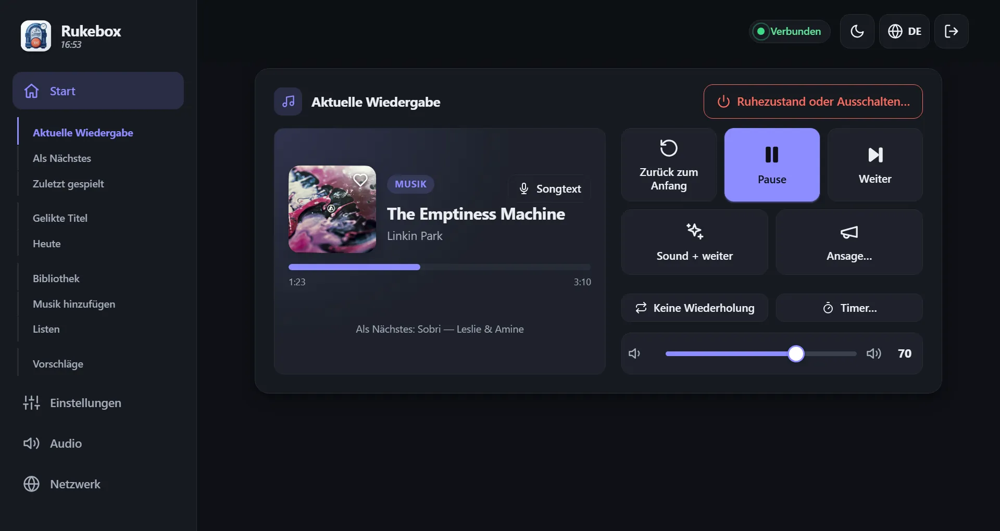
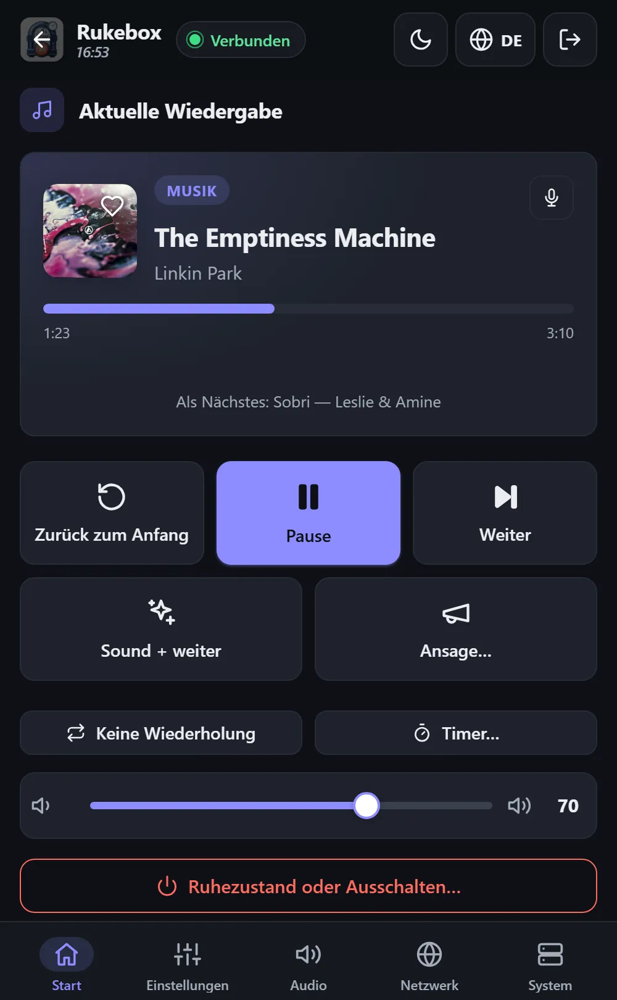
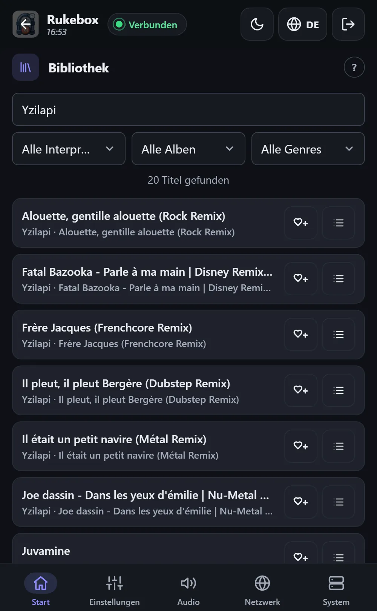

<p align="center"></p>

<p align="center"><a href="README.md">English</a> · <a href="README.fr.md">Français</a> · <b>Deutsch</b> · <a href="README.es.md">Español</a> · <a href="README.it.md">Italiano</a> · <a href="README.nl.md">Nederlands</a></p>

# 📻 Rukebox

**Deine Musik, ein Bluetooth-Lautsprecher und ein Raspberry Pi Zero: ein
Radio, das den Tag von selbst gestaltet.** Es weckt das Haus, sagt, worum du
es bittest, startet die Party und schaltet sich nachts aus. Kein Internet
nötig, kein Konto, keine App: Jedes Handy in seinem WLAN ist die
Fernbedienung.

<p align="center"></p>

<p align="center"> &nbsp; </p>

## ✨ Ein Tag mit Rukebox

- 🌅 **Morgens** - der Lichtstreifen geht auf wie eine Morgendämmerung, dann
  blendet sich die Musik von selbst ein. Heute Geburtstag? Das Radio sagt es -
  mit deiner eigenen Stimme, wenn du sie aufgenommen hast.
- 🎶 **Den ganzen Tag** - deine Bibliothek, deine Listen, ein Webradio, wenn
  es Internet gibt, oder was ein Handy ihm schickt. Ansagen und Jingles
  jeweils zu ihrer Zeit, sogar „jedes zweite Mal".
- 🎉 **Die Party** - ein Tipp auf den Timer: Lautstärke, Licht und
  Gastzugang der Party für 3 h, 6 h oder bis du sie beendest, mit einem Wort
  vor dem Ende. Gäste scannen einen QR-Code, wünschen Lieder, stimmen fürs
  Überspringen ab, spielen ein Musikquiz.
- 🌙 **Nachts** - es schläft am Ende eines Liedes ein, warnt vor dem
  Abschalten und schaltet sich selbst aus.
- 🎛️ **In deiner Hand** - ein Flic-Button, ein Drehknopf, eine
  Fernbedienung, die Tasten des Lautsprechers, RFID-Karten, die ein Album
  starten: Jede Geste tut, was du wählst.
- 🏠 **Zu Hause** - Home Assistant findet es von selbst (MQTT und ein
  DLNA-Mediaplayer), und WLED-Lichtstreifen folgen der Musik und ihrem Takt.
- 🛡️ **Ohne Aufsicht** - es hält den Lautsprecher verbunden, kennt die Uhrzeit
  ohne Internet, startet sich neu, falls es hängt, schont seine SD-Karte und
  sagt dir auf dem Bildschirm, wenn etwas dich braucht.

## 📱 Eine Seite für alles

Auf Handy, Tablet oder Computer, in sechs Sprachen, hell oder dunkel: die
aktuelle Wiedergabe mit Cover und Liedtext, die Bibliothek, Tags und Cover
direkt in den Dateien, die Statistik und alle Einstellungen. Eine einfache
Ansicht für jeden Tag, alle Optionen, wenn du sie willst, und beim ersten
Mal ein kurzer Rundgang. Konten halten die Einstellungen bei denen, denen
sie gehören.

## 🧰 Was du brauchst

- Einen Raspberry Pi Zero 2 W (andere Raspberry-Pi-Modelle gehen auch)
- Eine microSD-Karte (ab 8 GB) und ein Netzteil
- Raspberry Pi OS Bookworm oder neuer (oder Debian 12+ für einen Container): mindestens Python 3.11
- Einen Bluetooth-Lautsprecher - oder einen Kabelausgang: Klinke,
  USB-Soundkarte oder HDMI
- Empfohlen: ein DS3231-Uhrmodul, damit der Pi die Uhrzeit ohne Internet
  behält
- Optional: einen Flic-Button, einen Taster oder einen Drehknopf an den
  GPIO-Pins

## 🚀 Los geht's

1. **Karte beschreiben** mit dem [Raspberry Pi Imager](https://www.raspberrypi.com/software/):
   *Raspberry Pi OS Lite* wählen. Wenn du dessen Einstellungen ausfüllst,
   muss der Benutzername `pi` lauten.
2. **Karte vorbereiten**: `rukebox-setup.html` aus der
   [neuesten Version](https://github.com/Arubinu/Rukebox/releases)
   herunterladen, im Browser öffnen, die Karte wählen und ein paar
   Fragen beantworten (WLAN, Zugangspunkt, Zeitzone, Musik).
3. **Pi starten**: Er installiert alles selbst und zeigt den Fortschritt
   auf einer Webseite. Einmal braucht er Internet - über WLAN, ein
   Ethernet-Kabel oder den USB-Anschluss deines Computers.
4. **Verbinden**: Mit dem Handy dem WLAN des Pi beitreten (standardmäßig
   *Rukebox*). Die Oberfläche öffnet sich von selbst, sonst
   `http://10.42.0.1` aufrufen.

Du hast schon einen Raspberry Pi mit SSH-Zugang?

```bash
git clone https://github.com/Arubinu/Rukebox.git && cd Rukebox
sudo ./scripts/install.sh
```

**Kein Pi?** Rukebox läuft mit Docker auch in einem Container (NAS, Mini-PC,
Server) - ohne Access Point, GPIO und Hardware-Uhr:

```bash
docker compose -f docker/compose.stream.yml up -d
```

Gehört wird die Musik über „Hier hören" in der Oberfläche, in VLC oder auf
einem Netzwerklautsprecher ([Details](docs/guide.md#running-in-a-container-docker)). **Noch einfacher**: Öffne `rukebox-server.html`
aus der [neuesten Version](https://github.com/Arubinu/Rukebox/releases) und
beantworte ein paar Fragen - die Seite schreibt die `docker-compose.yml`, den
Portainer- oder Dockge-Stack oder den Befehl für einen Proxmox-LXC-Container.

## 🎛️ Im Alltag

| Geste | Standard |
|---|---|
| Einfacher Klick | Ein kurzer Ton, dann der nächste Titel (startet die Musik, wenn sie aus ist) |
| Doppelklick | Eine Ansage, dann der nächste Titel |
| Langer Druck | Ausblenden und den Pi ausschalten - oder nur Ruhezustand |

Jede Geste lässt sich ändern, und alles ist auch auf dem Bildschirm. Updates
werden mit einem Klick aus der Oberfläche installiert, wenn der Pi Internet
hat, oder vom Computer über das USB-Kabel.

## 📚 Mehr erfahren

- [Referenzhandbuch](docs/guide.md): Installationsvarianten, alle
  Einstellungen, Netzwerk, Updates und Fehlersuche (auf Englisch).
- Tests: `python3 tests/run.py`, und `npm test` für die Seite.
- Icons: [Lucide](https://lucide.dev), ISC-Lizenz - siehe den [Hinweis](docs/THIRD-PARTY.md).

Ideen und Beiträge sind willkommen - eröffne ein Issue oder einen Pull
Request.
