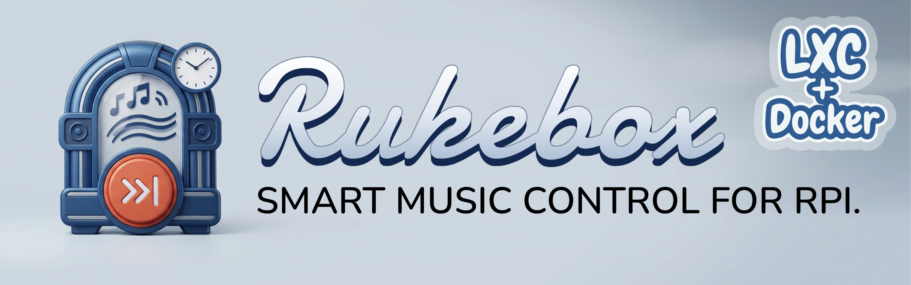
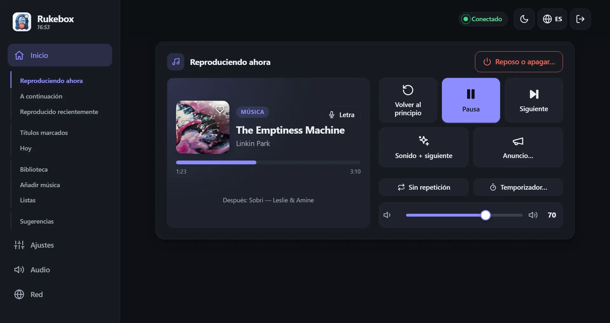
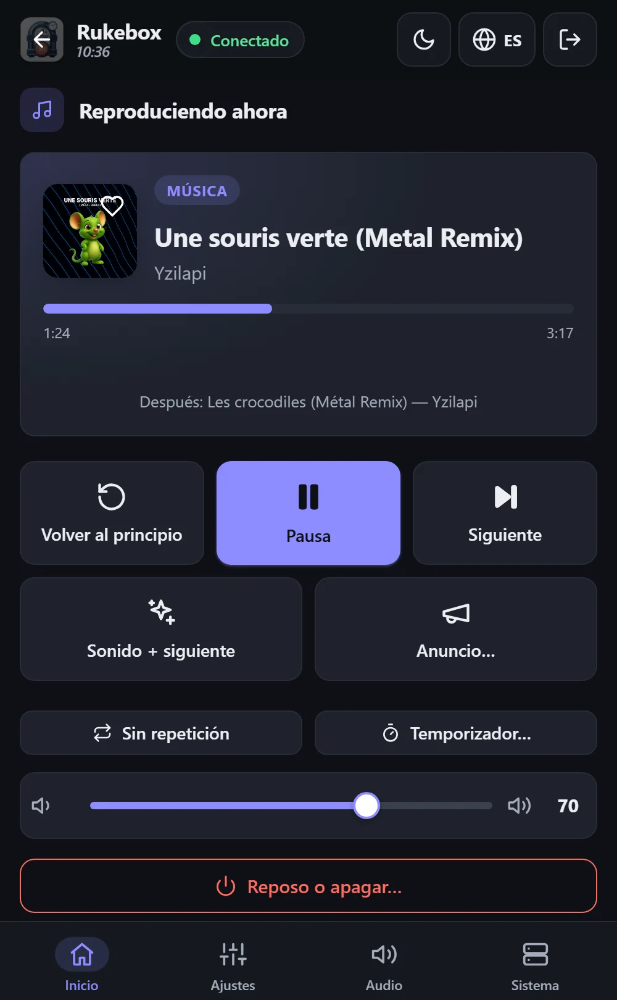
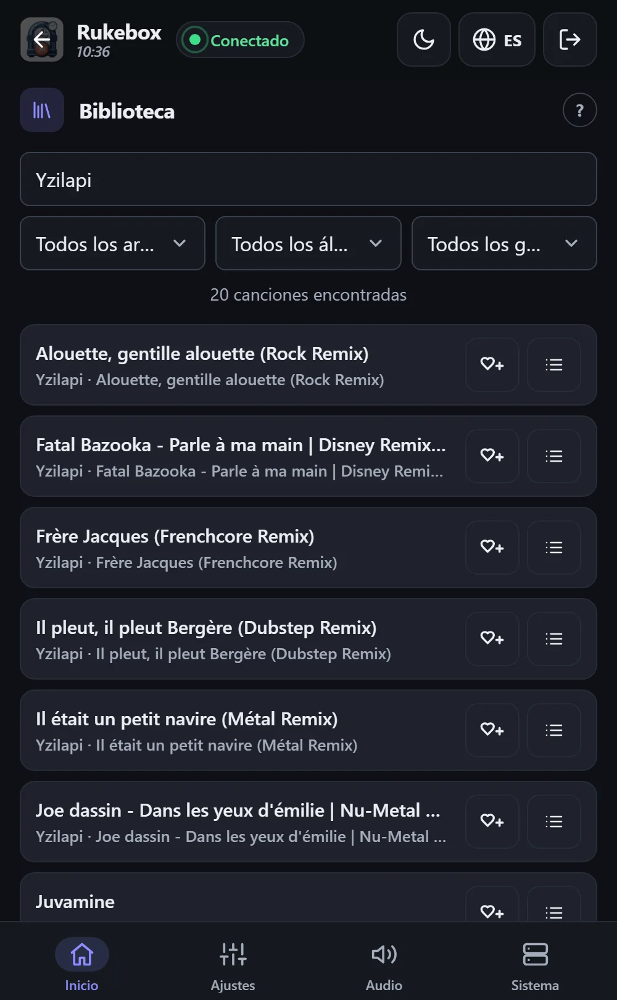

<p align="center"></p>

<p align="center"><a href="README.md">English</a> · <a href="README.fr.md">Français</a> · <a href="README.de.md">Deutsch</a> · <b>Español</b> · <a href="README.it.md">Italiano</a> · <a href="README.nl.md">Nederlands</a></p>

# 📻 Rukebox

**Tu música, un altavoz Bluetooth y una Raspberry Pi Zero: una radio que
lleva el día sola.** Despierta la casa, dice lo que le pides, anima la fiesta
y se apaga por la noche. Sin Internet, sin cuenta, sin aplicación: cualquier
móvil en su Wi-Fi es el mando.

<p align="center"></p>

<p align="center"> &nbsp; </p>

## ✨ Un día con Rukebox

- 🌅 **Por la mañana** - la tira de luz se enciende como un amanecer y la
  música sube sola. ¿Hoy es un cumpleaños? La radio lo dice - con tu propia
  voz si la has grabado.
- 🎶 **Todo el día** - tu biblioteca, tus listas, una radio web cuando hay
  Internet, o lo que un móvil le envía. Anuncios y sintonías cada uno a su
  hora, e incluso «una vez de cada dos». Sus carpetas pueden llenarse solas
  desde un NAS o un ordenador, a la hora que elijas.
- 🎉 **La fiesta** - un toque en el temporizador: el volumen, las luces y el
  acceso de invitados de la fiesta durante 3 h, 6 h o hasta que la pares, con
  un aviso antes del final. Los invitados escanean un código QR, añaden
  canciones, votan para saltar y juegan a adivinar la canción.
- 🌙 **Por la noche** - se duerme al final de una canción, avisa antes del
  apagado y se apaga sola.
- 🎛️ **A mano** - un botón Flic, un botón giratorio, un mando, los botones
  del altavoz, tarjetas RFID que lanzan un álbum: cada gesto hace lo que
  elijas.
- 🏠 **En casa** - Home Assistant la encuentra solo (MQTT y un reproductor
  multimedia DLNA), y las tiras WLED siguen la música y su ritmo.
- 🛡️ **Sin vigilancia** - mantiene el altavoz conectado, sabe la hora sin
  Internet, se reinicia sola si se bloquea, cuida su tarjeta SD y te avisa
  en pantalla cuando algo te necesita.

## 📱 Una sola página para todo

En el móvil, la tableta o el ordenador, en seis idiomas, claro u oscuro: la
reproducción en curso con carátula y letra, la biblioteca, las etiquetas y
carátulas escritas en los archivos, las estadísticas y todos los ajustes. Una
vista simple para cada día, todas las opciones cuando las quieras y una
breve visita guiada la primera vez. Las cuentas dejan los ajustes a quien
le corresponden.

## 🧰 Qué necesitas

- Una Raspberry Pi Zero 2 W (otros modelos de Raspberry Pi también sirven)
- Una tarjeta microSD (8 GB o más) y una fuente de alimentación
- Raspberry Pi OS Bookworm o posterior (o Debian 12+ para un contenedor): Python 3.11 como mínimo
- Un altavoz Bluetooth - o una salida por cable: jack, tarjeta de sonido
  USB o HDMI
- Recomendado: un módulo de reloj DS3231, para que la Pi conserve la hora
  sin Internet
- Opcional: un botón Flic, un pulsador o un botón giratorio en los pines
  GPIO

## 🚀 Primeros pasos

1. **Graba la tarjeta** con [Raspberry Pi Imager](https://www.raspberrypi.com/software/)
   eligiendo *Raspberry Pi OS Lite*. Si rellenas sus ajustes, el nombre de
   usuario debe ser `pi`.
2. **Prepara la tarjeta**: descarga `rukebox-setup.html` de la
   [última versión](https://github.com/Arubinu/Rukebox/releases), ábrelo en
   tu navegador, elige la tarjeta y responde a unas preguntas (Wi-Fi, punto
   de acceso, zona horaria, música).
3. **Enciende la Pi**: lo instala todo sola y muestra el progreso en una
   página web. Necesita Internet una sola vez - por Wi-Fi, un cable
   Ethernet o el puerto USB de tu ordenador.
4. **Conéctate**: únete al Wi-Fi de la Pi (*Rukebox* por defecto) con tu
   móvil. La interfaz se abre sola; si no, ve a `http://10.42.0.1`.

¿Ya tienes una Raspberry Pi con acceso SSH?

```bash
git clone https://github.com/Arubinu/Rukebox.git && cd Rukebox
sudo ./scripts/install.sh
```

**¿Sin Raspberry Pi?** Rukebox también funciona en un contenedor (un NAS, un
mini-PC, un servidor) con Docker, sin el punto de acceso, los GPIO ni el reloj
de hardware:

```bash
docker compose -f docker/compose.stream.yml up -d
```

La música se escucha con «Escuchar aquí» en la interfaz, en VLC o en un
altavoz de red ([detalles](docs/guide.md#running-in-a-container-docker)). **Más sencillo aún**: abre `rukebox-server.html` de la
[última versión](https://github.com/Arubinu/Rukebox/releases) y responde a unas
preguntas - escribe el `docker-compose.yml`, la pila de Portainer o Dockge, o
el comando para un contenedor LXC de Proxmox.

## 🎛️ En el día a día

| Gesto | Por defecto |
|---|---|
| Clic simple | Un sonido corto y la canción siguiente (inicia la música si está parada) |
| Doble clic | Un anuncio y la canción siguiente |
| Pulsación larga | Baja el volumen poco a poco y apaga la Pi - o solo reposo |

Cada gesto se puede cambiar, y todo está también en pantalla. Las
actualizaciones se instalan desde la interfaz con un clic cuando la Pi tiene
Internet, o desde tu ordenador por el cable USB.

## 📚 Saber más

- [Guía de referencia](docs/guide.md): opciones de instalación, todos los
  ajustes, red, actualizaciones y resolución de problemas (en inglés).
- Pruebas: `python3 tests/run.py`, y `npm test` para la página.
- Iconos: [Lucide](https://lucide.dev), licencia ISC - ver el [aviso](docs/THIRD-PARTY.md).

Las ideas y contribuciones son bienvenidas: abre un issue o un pull
request.
