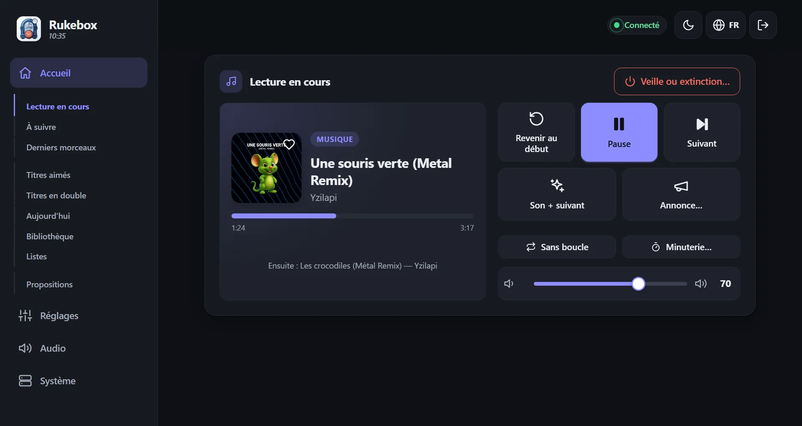
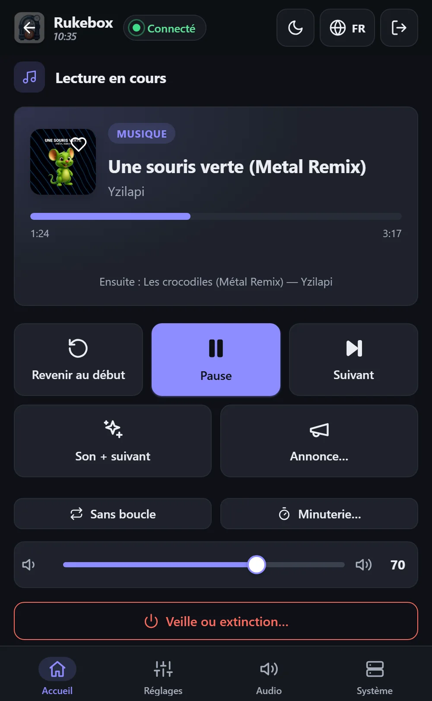
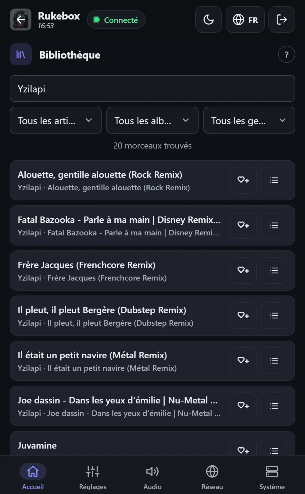

<p align="center"></p>

<p align="center"><a href="README.md">English</a> · <b>Français</b> · <a href="README.de.md">Deutsch</a> · <a href="README.es.md">Español</a> · <a href="README.it.md">Italiano</a> · <a href="README.nl.md">Nederlands</a></p>

# 📻 Rukebox

**Ta musique, une enceinte Bluetooth et un Raspberry Pi Zero : une radio qui
mène la journée toute seule.** Elle réveille la maison, dit ce que tu lui
demandes, lance la soirée et s'éteint la nuit. Sans Internet, sans compte,
sans application : n'importe quel téléphone sur son Wi-Fi sert de
télécommande.

<p align="center"></p>

<p align="center"> &nbsp; </p>

## ✨ Une journée avec Rukebox

- 🌅 **Le matin** - le ruban lumineux se lève comme une aube, puis la
  musique monte toute seule. Un anniversaire aujourd'hui ? La radio le dit -
  avec ta propre voix si tu l'as enregistrée.
- 🎶 **Toute la journée** - ta bibliothèque, tes listes, une radio web quand
  il y a Internet, ou ce qu'un téléphone lui envoie. Annonces et jingles
  chacun à son heure, et même « une fois sur deux ». Ses dossiers peuvent se
  remplir seuls depuis un NAS ou un ordinateur, à heure fixe.
  Plusieurs listes jouent ensemble, d'autres sont écartées, une liste passe
  juste après, et « À suivre » se réordonne d'un appui long.
- 🎉 **La soirée** - un appui sur la minuterie : le volume, les lumières et
  l'accès invités de la soirée pour 3 h, 6 h ou jusqu'à ce que tu l'arrêtes,
  avec un mot avant la fin. Les invités scannent un QR code, ajoutent des
  morceaux, votent pour passer, jouent au blind test.
- 🌙 **La nuit** - elle s'endort à la fin d'une chanson, prévient avant la
  coupure et s'éteint toute seule.
- 🎛️ **Sous la main** - un bouton Flic, un bouton rotatif, une
  télécommande, les boutons de l'enceinte, des cartes RFID qui lancent un
  album : chaque geste fait ce que tu choisis.
- 🏠 **À la maison** - Home Assistant la voit tout seul (MQTT, et un lecteur
  multimédia DLNA), et les rubans WLED suivent la musique et son rythme.
- 🛡️ **Sans surveillance** - elle garde l'enceinte connectée, connaît l'heure
  sans Internet, redémarre toute seule si elle se fige, ménage sa carte SD
  et te dit à l'écran quand quelque chose a besoin de toi.

## 📱 Une seule page pour tout

Sur téléphone, tablette ou ordinateur, en six langues, clair ou sombre : la
lecture en cours avec pochette et paroles, la bibliothèque, les tags et
pochettes écrits dans les fichiers, les statistiques et tous les réglages.
Une vue simple pour tous les jours, toutes les options quand tu les veux, et
une courte visite guidée la première fois. Les comptes gardent les réglages
à qui ils appartiennent.

## 🧰 Ce qu'il te faut

- Un Raspberry Pi Zero 2 W (les autres Raspberry Pi fonctionnent aussi)
- Une carte microSD (8 Go ou plus) et une alimentation
- Raspberry Pi OS Bookworm ou plus récent (ou Debian 12+ pour un conteneur) : Python 3.11 au minimum
- Une enceinte Bluetooth - ou une sortie filaire : jack, carte son USB ou
  HDMI
- Conseillé : un module horloge DS3231, pour que le Pi garde l'heure sans
  Internet
- En option : un bouton Flic, un bouton-poussoir ou un bouton rotatif sur
  les broches GPIO

## 🚀 Pour commencer

1. **Prépare le système** avec [Raspberry Pi Imager](https://www.raspberrypi.com/software/)
   en choisissant *Raspberry Pi OS Lite*. Si tu remplis ses réglages, le
   nom d'utilisateur doit être `pi`.
2. **Prépare la carte** : télécharge `rukebox-setup.html` depuis la
   [dernière version](https://github.com/Arubinu/Rukebox/releases),
   ouvre-le dans ton navigateur, choisis la carte et réponds à quelques
   questions (Wi-Fi, point d'accès, fuseau horaire, musique).
3. **Démarre le Pi** : il installe tout seul et affiche sa progression sur
   une page web. Il a besoin d'Internet une seule fois - par le Wi-Fi, un
   câble Ethernet ou le port USB de ton ordinateur.
4. **Connecte-toi** : rejoins le Wi-Fi du Pi (*Rukebox* par défaut) avec
   ton téléphone. L'interface s'ouvre toute seule, sinon va sur
   `http://10.42.0.1`.

Tu as déjà un Raspberry Pi accessible en SSH ?

```bash
git clone https://github.com/Arubinu/Rukebox.git && cd Rukebox
sudo ./scripts/install.sh
```

**Pas de Pi ?** Rukebox tourne aussi dans un conteneur (NAS, mini-PC,
serveur) avec Docker, sans le point d'accès, les GPIO ni l'horloge
matérielle :

```bash
docker compose -f docker/compose.stream.yml up -d
```

La musique s'écoute avec « Écouter ici » dans l'interface, dans VLC, ou sur
une enceinte réseau ([détails](docs/guide.md#running-in-a-container-docker)). **Plus simple encore** : ouvre `rukebox-server.html`
depuis la [dernière version](https://github.com/Arubinu/Rukebox/releases) et
réponds à quelques questions - elle écrit le `docker-compose.yml`, la pile
Portainer ou Dockge, ou la commande pour un conteneur LXC Proxmox.

## 🎛️ Au quotidien

| Geste | Par défaut |
|---|---|
| Clic simple | Un court son, puis le morceau suivant (lance la musique si elle est arrêtée) |
| Double clic | Une annonce, puis le morceau suivant |
| Appui long | Arrêt en fondu et extinction du Pi - ou seulement la mise en veille |

Chaque geste se change, et tout est aussi à l'écran. Les mises à jour
s'installent depuis l'interface en un clic quand le Pi a Internet, ou depuis
ton ordinateur par le câble USB.

## 📚 Pour aller plus loin

- [Guide de référence](docs/guide.md) : options d'installation, tous les
  réglages, réseau, mises à jour et dépannage (en anglais).
- Tests : `python3 tests/run.py`, et `npm test` pour la page.
- Icônes : [Lucide](https://lucide.dev), licence ISC - voir la [notice](docs/THIRD-PARTY.md).

Les idées et contributions sont les bienvenues - ouvre une issue ou une
pull request.
