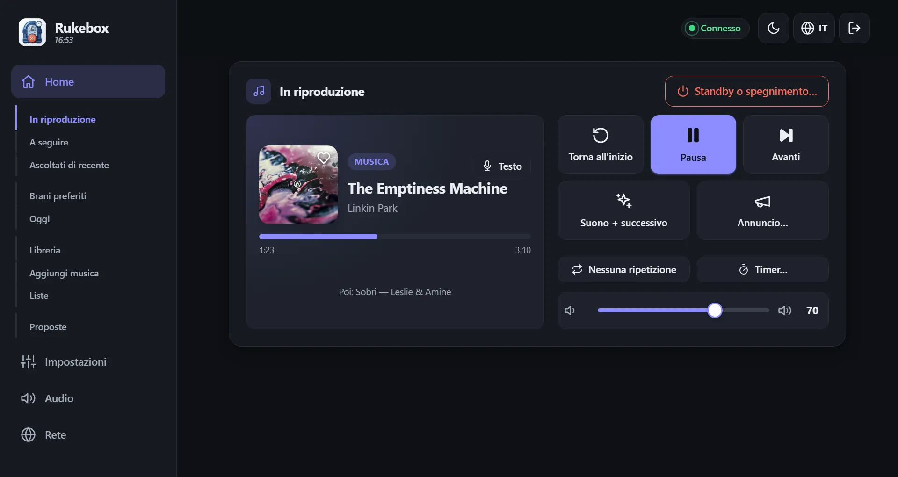
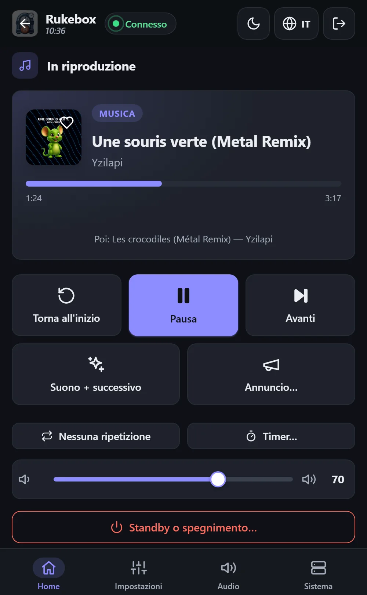
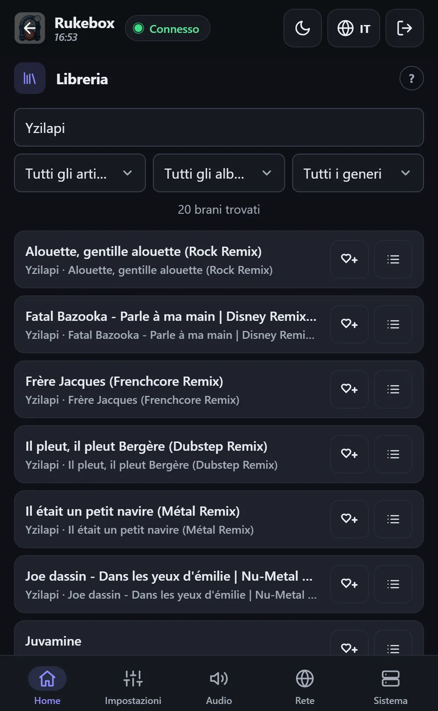

<p align="center"></p>

<p align="center"><a href="README.md">English</a> · <a href="README.fr.md">Français</a> · <a href="README.de.md">Deutsch</a> · <a href="README.es.md">Español</a> · <b>Italiano</b> · <a href="README.nl.md">Nederlands</a></p>

# 📻 Rukebox

**La tua musica, una cassa Bluetooth e un Raspberry Pi Zero: una radio che
manda avanti la giornata da sola.** Sveglia la casa, dice quello che le
chiedi, accende la festa e si spegne di notte. Niente Internet, nessun
account, nessuna app: qualsiasi telefono sul suo Wi-Fi è il telecomando.

<p align="center"></p>

<p align="center"> &nbsp; </p>

## ✨ Una giornata con Rukebox

- 🌅 **Al mattino** - la striscia luminosa sorge come un'alba, poi la musica
  sale da sola. Oggi è un compleanno? La radio lo dice - con la tua voce, se
  l'hai registrata.
- 🎶 **Tutto il giorno** - la tua libreria, le tue liste, una web radio quando
  c'è Internet, o quello che un telefono le manda. Annunci e jingle ciascuno
  alla sua ora, persino «una volta su due».
- 🎉 **La festa** - un tocco sul timer: il volume, le luci e l'accesso degli
  ospiti della festa per 3 h, 6 h o finché non la fermi, con una parola prima
  della fine. Gli ospiti inquadrano un codice QR, aggiungono brani, votano per
  saltare, giocano a indovinare la canzone.
- 🌙 **La notte** - si addormenta alla fine di una canzone, avvisa prima dello
  spegnimento e si spegne da sola.
- 🎛️ **A portata di mano** - un pulsante Flic, una manopola, un telecomando, i
  tasti della cassa, schede RFID che avviano un album: ogni gesto fa ciò che
  scegli.
- 🏠 **In casa** - Home Assistant la trova da solo (MQTT e un lettore
  multimediale DLNA), e le strisce WLED seguono la musica e il suo ritmo.
- 🛡️ **Senza sorveglianza** - tiene collegata la cassa, conosce l'ora senza
  Internet, si riavvia da sola se si blocca, risparmia la sua scheda SD e ti
  dice sullo schermo quando qualcosa ha bisogno di te.

## 📱 Una sola pagina per tutto

Su telefono, tablet o computer, in sei lingue, chiara o scura: la
riproduzione in corso con copertina e testo, la libreria, i tag e le
copertine scritti nei file, le statistiche e tutte le impostazioni. Una vista
semplice per ogni giorno, tutte le opzioni quando le vuoi, e una breve visita
guidata la prima volta. Gli account lasciano le impostazioni a chi spettano.

## 🧰 Cosa serve

- Un Raspberry Pi Zero 2 W (vanno bene anche gli altri modelli)
- Una scheda microSD (8 GB o più) e un alimentatore
- Raspberry Pi OS Bookworm o successivo (o Debian 12+ per un container): almeno Python 3.11
- Una cassa Bluetooth - oppure un'uscita via cavo: jack, scheda audio USB o
  HDMI
- Consigliato: un modulo orologio DS3231, perché il Pi mantenga l'ora
  senza Internet
- Facoltativo: un pulsante Flic, un pulsante o una manopola sui pin GPIO

## 🚀 Per iniziare

1. **Scrivi la scheda** con [Raspberry Pi Imager](https://www.raspberrypi.com/software/)
   scegliendo *Raspberry Pi OS Lite*. Se compili le sue impostazioni, il
   nome utente deve essere `pi`.
2. **Prepara la scheda**: scarica `rukebox-setup.html` dall'
   [ultima versione](https://github.com/Arubinu/Rukebox/releases), aprilo
   nel tuo browser, scegli la scheda e rispondi a qualche domanda (Wi-Fi,
   punto di accesso, fuso orario, musica).
3. **Avvia il Pi**: installa tutto da solo e mostra l'avanzamento su una
   pagina web. Ha bisogno di Internet una sola volta - via Wi-Fi, con un
   cavo Ethernet o dalla porta USB del tuo computer.
4. **Collegati**: entra nel Wi-Fi del Pi (*Rukebox* di default) con il
   telefono. L'interfaccia si apre da sola; altrimenti vai su
   `http://10.42.0.1`.

Hai già un Raspberry Pi con accesso SSH?

```bash
git clone https://github.com/Arubinu/Rukebox.git && cd Rukebox
sudo ./scripts/install.sh
```

**Niente Raspberry Pi?** Rukebox gira anche in un container (un NAS, un
mini-PC, un server) con Docker, senza access point, GPIO e orologio
hardware:

```bash
docker compose -f docker/compose.stream.yml up -d
```

La musica si ascolta con «Ascolta qui» nell'interfaccia, in VLC o su un
diffusore di rete ([dettagli](docs/guide.md#running-in-a-container-docker)). **Ancora più semplice**: apri `rukebox-server.html`
dall'[ultima versione](https://github.com/Arubinu/Rukebox/releases) e rispondi a
qualche domanda - scrive il `docker-compose.yml`, lo stack per Portainer o
Dockge, o il comando per un container LXC Proxmox.

## 🎛️ Nell'uso quotidiano

| Gesto | Di default |
|---|---|
| Clic singolo | Un breve suono, poi il brano successivo (avvia la musica se è ferma) |
| Doppio clic | Un annuncio, poi il brano successivo |
| Pressione lunga | Dissolvenza e spegnimento del Pi - oppure solo standby |

Ogni gesto si può cambiare, e tutto è anche sullo schermo. Gli aggiornamenti
si installano dall'interfaccia con un clic quando il Pi ha Internet, oppure
dal computer tramite il cavo USB.

## 📚 Per saperne di più

- [Guida di riferimento](docs/guide.md): opzioni di installazione, tutte le
  impostazioni, rete, aggiornamenti e risoluzione dei problemi (in inglese).
- Test: `python3 tests/run.py`, e `npm test` per la pagina.
- Icone: [Lucide](https://lucide.dev), licenza ISC - vedi l'[avviso](docs/THIRD-PARTY.md).

Idee e contributi sono benvenuti: apri una issue o una pull request.
