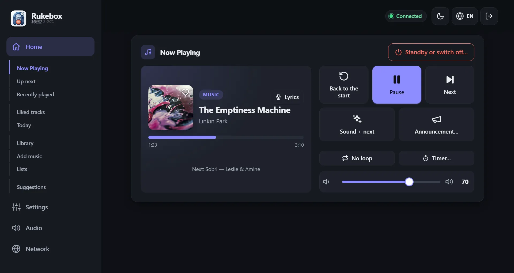
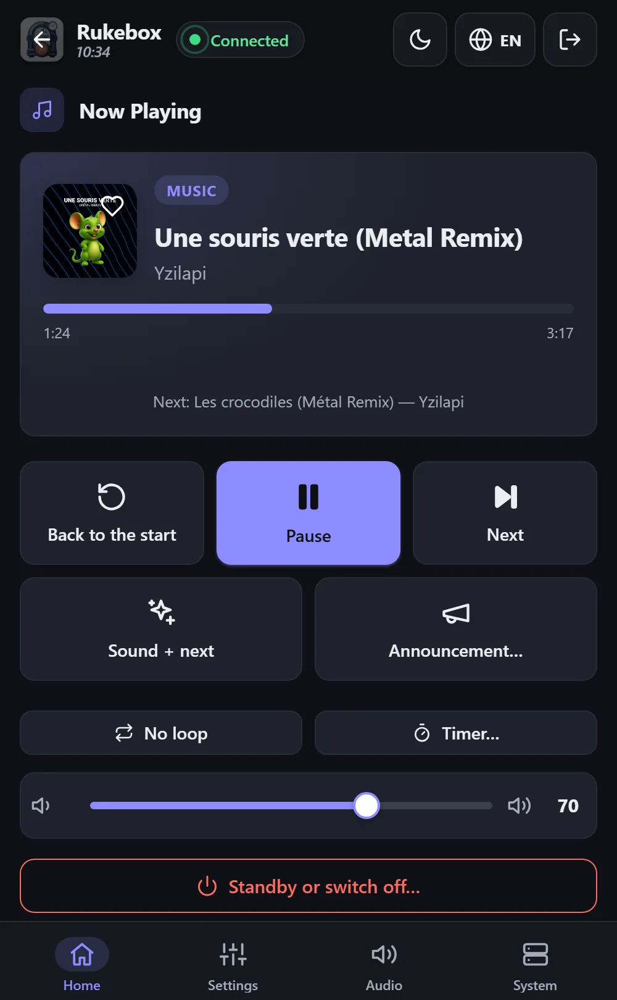
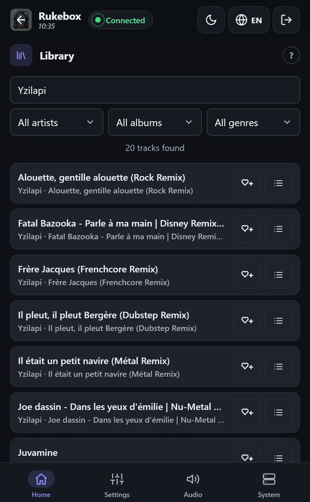

<p align="center"></p>

<p align="center"><b>English</b> · <a href="README.fr.md">Français</a> · <a href="README.de.md">Deutsch</a> · <a href="README.es.md">Español</a> · <a href="README.it.md">Italiano</a> · <a href="README.nl.md">Nederlands</a></p>

# 📻 Rukebox

**Your music, a Bluetooth speaker and a Raspberry Pi Zero: a radio that runs
the day by itself.** It wakes the house, says what you ask it to, throws the
party and switches itself off at night. No Internet needed, no account, no
app: any phone on its Wi-Fi is the remote.

<p align="center"></p>

<p align="center"> &nbsp; </p>

## ✨ A day with Rukebox

- 🌅 **Morning** - the light strip rises like a dawn, then the music fades in
  on its own. A birthday today? The radio says it - in your own voice if you
  recorded it.
- 🎶 **All day** - your library, your lists, a web radio when there is
  Internet, or what a phone sends it. Announcements and jingles each on
  their own schedule, even "one time out of two". Its folders can fill
  themselves from a NAS or a computer, on their own schedule.
- 🎉 **The party** - one tap on the timer: the party's volume, lights and
  guest access for 3 h, 6 h or until you stop it, with a word before it ends.
  Guests scan a QR code, queue songs, vote to skip, play a blind test.
- 🌙 **Night** - it falls asleep at the end of a song, warns before the
  cutoff and switches itself off.
- 🎛️ **In your hands** - a Flic button, a rotary knob, a remote, the
  speaker's own buttons, RFID cards that start an album: each gesture does
  what you choose.
- 🏠 **At home** - Home Assistant sees it by itself (MQTT, and a DLNA media
  player), and WLED light strips follow the music and its beat.
- 🛡️ **Unattended** - it keeps the speaker connected, knows the time without
  Internet, restarts itself if it ever hangs, spares its SD card, and says
  on screen when something needs you.

## 📱 One page for everything

On a phone, a tablet or a computer, in six languages, light or dark: now
playing with cover and lyrics, the library, tags and covers written into
the files, the statistics and every setting. A simple view for every day,
every option when you want them, and a short guided tour the first time.
Accounts keep the settings to whom they belong.

## 🧰 What you need

- A Raspberry Pi Zero 2 W (other Raspberry Pi models work too)
- A microSD card (8 GB or more) and a power supply
- Raspberry Pi OS Bookworm or later (or Debian 12+ for a container): Python 3.11 at least
- A Bluetooth speaker - or a wired output: jack, USB sound card or HDMI
- Recommended: a DS3231 real-time clock module, so the Pi keeps the time
  without Internet
- Optional: a Flic button, a push-button or a rotary knob on the GPIO pins

## 🚀 Getting started

1. **Flash the card** with [Raspberry Pi Imager](https://www.raspberrypi.com/software/)
   and choose *Raspberry Pi OS Lite*. If you fill in its settings, the user
   name must be `pi`.
2. **Prepare the card**: download `rukebox-setup.html` from the
   [latest release](https://github.com/Arubinu/Rukebox/releases), open it
   in your browser, select the card and answer a few questions (Wi-Fi,
   access point, time zone, music).
3. **Start the Pi**: it installs everything by itself and shows its
   progress on a web page. It needs Internet once - through Wi-Fi, an
   Ethernet cable or your computer's USB port.
4. **Connect**: join the Pi's Wi-Fi (*Rukebox* by default) with your
   phone. The interface opens by itself, or go to `http://10.42.0.1`.

Already have a Raspberry Pi with SSH access?

```bash
git clone https://github.com/Arubinu/Rukebox.git && cd Rukebox
sudo ./scripts/install.sh
```

**No Pi?** Rukebox also runs in a container (a NAS, a mini-PC, a server) with
Docker, without the access point, the GPIO and the hardware clock:

```bash
docker compose -f docker/compose.stream.yml up -d
```

The music is heard with "Listen here" in the interface, in VLC, or on a
network speaker ([details](docs/guide.md#running-in-a-container-docker)). **Simpler still**: open `rukebox-server.html` from the
[latest release](https://github.com/Arubinu/Rukebox/releases) and answer a few
questions - it writes the `docker-compose.yml`, the Portainer or Dockge stack,
or the one command for a Proxmox LXC container.

## 🎛️ Everyday use

| Gesture | By default |
|---|---|
| Single click | A short sound, then the next song (starts the music when it is off) |
| Double click | An announcement, then the next song |
| Long press | Fades out and switches the Pi off - or only standby |

Every gesture can be changed, and everything is also on screen. Updates
install from the interface in one click when the Pi has Internet, or from
your computer over the USB cable.

## 📚 Learn more

- [Reference guide](docs/guide.md): installation options, every setting,
  networking, updates and troubleshooting (in English).
- Tests: `python3 tests/run.py`, and `npm test` for the page.
- Icons: [Lucide](https://lucide.dev), ISC License - see the [notice](docs/THIRD-PARTY.md).

Ideas and contributions are welcome - open an issue or a pull request.
