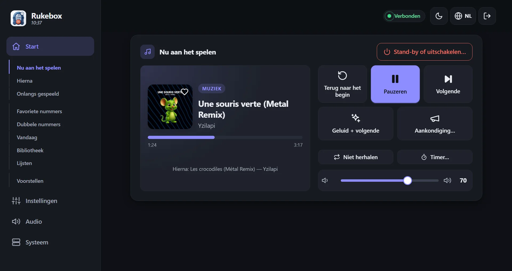
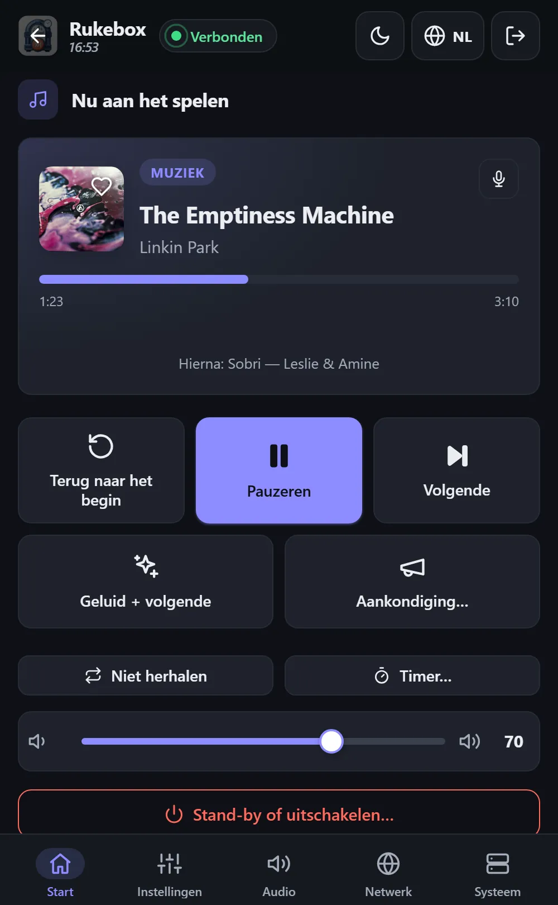
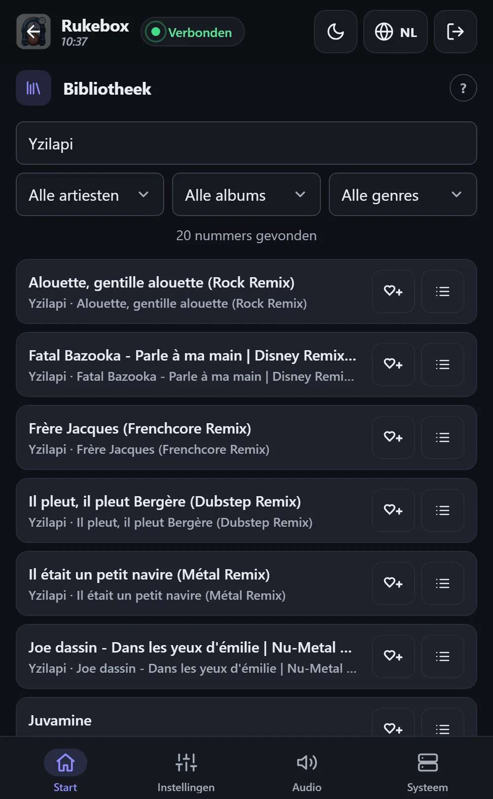

<p align="center"></p>

<p align="center"><a href="README.md">English</a> · <a href="README.fr.md">Français</a> · <a href="README.de.md">Deutsch</a> · <a href="README.es.md">Español</a> · <a href="README.it.md">Italiano</a> · <b>Nederlands</b></p>

# 📻 Rukebox

**Je muziek, een Bluetooth-speaker en een Raspberry Pi Zero: een radio die de
dag zelf regelt.** Hij maakt het huis wakker, zegt wat je hem vraagt, zet het
feest in gang en schakelt zichzelf 's nachts uit. Geen internet nodig, geen
account, geen app: elke telefoon op zijn wifi is de afstandsbediening.

<p align="center"></p>

<p align="center"> &nbsp; </p>

## ✨ Een dag met Rukebox

- 🌅 **'s Ochtends** - de lichtstrip gaat op als een dageraad, daarna komt de
  muziek vanzelf op. Vandaag een verjaardag? De radio zegt het - met je eigen
  stem als je die hebt opgenomen.
- 🎶 **De hele dag** - je bibliotheek, je lijsten, een webradio als er
  internet is, of wat een telefoon hem stuurt. Mededelingen en jingles elk
  op hun eigen moment, zelfs "één keer op twee". Zijn mappen kunnen zich
  vanzelf vullen vanaf een NAS of computer, op vaste tijden.
  Meerdere lijsten spelen samen, andere blijven buiten, een lijst komt hierna
  aan de beurt, en ‘Hierna’ herschik je met lang drukken.
- 🎉 **Het feest** - één tik op de timer: het volume, de lichten en de
  gasttoegang van het feest voor 3 u, 6 u of tot je het stopt, met een woord
  voor het einde. Gasten scannen een QR-code, zetten nummers in de rij,
  stemmen om over te slaan, spelen een muziekquiz.
- 🌙 **'s Nachts** - hij valt in slaap aan het eind van een nummer,
  waarschuwt voor het uitschakelen en schakelt zichzelf uit.
- 🎛️ **Bij de hand** - een Flic-knop, een draaiknop, een afstandsbediening,
  de knoppen van de speaker, RFID-kaarten die een album starten: elk gebaar
  doet wat jij kiest.
- 🏠 **In huis** - Home Assistant vindt hem vanzelf (MQTT en een
  DLNA-mediaspeler), en WLED-lichtstrips volgen de muziek en haar ritme.
- 🛡️ **Zonder toezicht** - hij houdt de speaker verbonden, kent de tijd zonder
  internet, start zichzelf opnieuw als hij vastloopt, spaart zijn SD-kaart en
  zegt het op het scherm als iets jou nodig heeft.

## 📱 Eén pagina voor alles

Op telefoon, tablet of computer, in zes talen, licht of donker: wat nu
speelt met hoes en songtekst, de bibliotheek, tags en hoezen in de bestanden
zelf, de statistieken en alle instellingen. Een eenvoudige weergave voor elke
dag, alle opties als je ze wilt, en de eerste keer een korte rondleiding.
Accounts laten de instellingen bij wie ze horen.

## 🧰 Wat je nodig hebt

- Een Raspberry Pi Zero 2 W (andere Raspberry Pi-modellen werken ook)
- Een microSD-kaart (8 GB of meer) en een voeding
- Raspberry Pi OS Bookworm of nieuwer (of Debian 12+ voor een container): minstens Python 3.11
- Een Bluetooth-speaker - of een bedrade uitgang: jack, USB-geluidskaart
  of HDMI
- Aanbevolen: een DS3231-klokmodule, zodat de Pi de tijd bijhoudt zonder
  internet
- Optioneel: een Flic-knop, een drukknop of een draaiknop op de GPIO-pinnen

## 🚀 Aan de slag

1. **Schrijf de kaart** met [Raspberry Pi Imager](https://www.raspberrypi.com/software/)
   en kies *Raspberry Pi OS Lite*. Vul je de instellingen daarvan in, dan
   moet de gebruikersnaam `pi` zijn.
2. **Bereid de kaart voor**: download `rukebox-setup.html` van de
   [nieuwste versie](https://github.com/Arubinu/Rukebox/releases), open het
   in je browser, kies de kaart en beantwoord een paar vragen (wifi,
   toegangspunt, tijdzone, muziek).
3. **Start de Pi**: hij installeert alles zelf en toont de voortgang op
   een webpagina. Hij heeft één keer internet nodig - via wifi, een
   ethernetkabel of de USB-poort van je computer.
4. **Verbind**: maak met je telefoon verbinding met de wifi van de Pi
   (standaard *Rukebox*). De interface opent vanzelf, anders ga je naar
   `http://10.42.0.1`.

Heb je al een Raspberry Pi met SSH-toegang?

```bash
git clone https://github.com/Arubinu/Rukebox.git && cd Rukebox
sudo ./scripts/install.sh
```

**Geen Raspberry Pi?** Rukebox draait met Docker ook in een container (een
NAS, een mini-pc, een server) - zonder accesspoint, GPIO en hardwareklok:

```bash
docker compose -f docker/compose.stream.yml up -d
```

De muziek hoor je met "Hier luisteren" in de interface, in VLC of op een
netwerkspeaker ([details](docs/guide.md#running-in-a-container-docker)). **Nog eenvoudiger**: open `rukebox-server.html` uit de
[nieuwste versie](https://github.com/Arubinu/Rukebox/releases) en beantwoord een
paar vragen - de pagina schrijft de `docker-compose.yml`, de Portainer- of
Dockge-stack, of de opdracht voor een Proxmox LXC-container.

## 🎛️ In het dagelijks gebruik

| Gebaar | Standaard |
|---|---|
| Enkele klik | Een kort geluid, dan het volgende nummer (start de muziek als die uit staat) |
| Dubbelklik | Een aankondiging, dan het volgende nummer |
| Lang indrukken | Uitfaden en de Pi uitschakelen - of alleen stand-by |

Elk gebaar is aan te passen, en alles staat ook op het scherm. Updates
installeer je met één klik vanuit de interface als de Pi internet heeft, of
vanaf je computer via de USB-kabel.

## 📚 Meer weten

- [Referentiegids](docs/guide.md): installatiemogelijkheden, alle
  instellingen, netwerk, updates en probleemoplossing (in het Engels).
- Tests: `python3 tests/run.py`, en `npm test` voor de pagina.
- Iconen: [Lucide](https://lucide.dev), ISC-licentie - zie de [vermelding](docs/THIRD-PARTY.md).

Ideeën en bijdragen zijn welkom - open een issue of een pull request.
